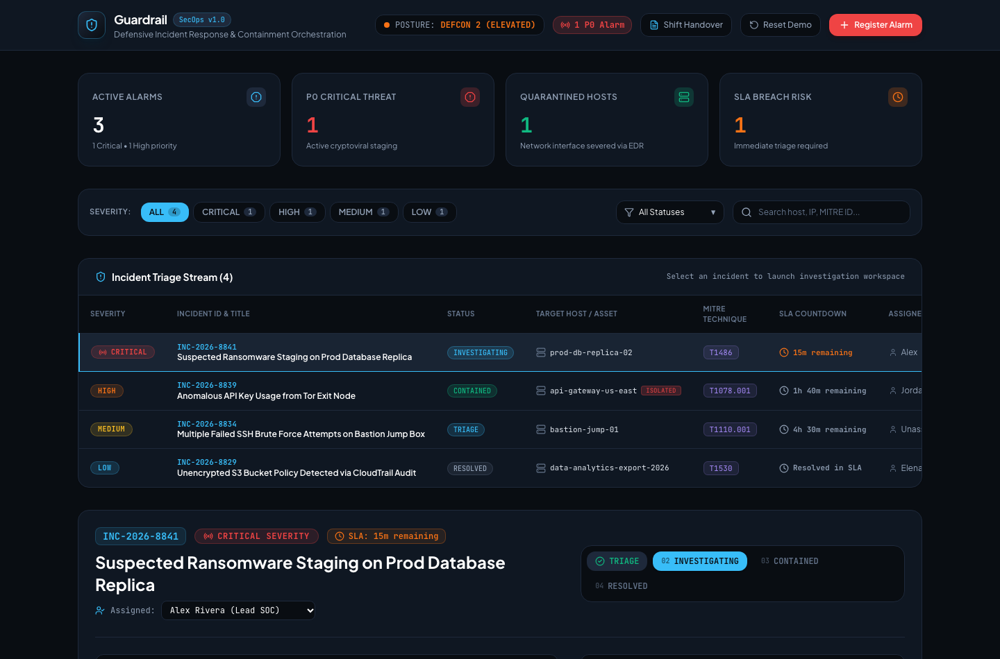
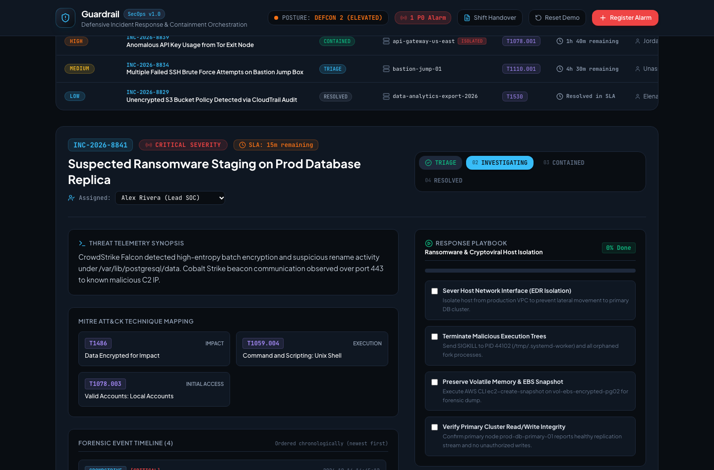
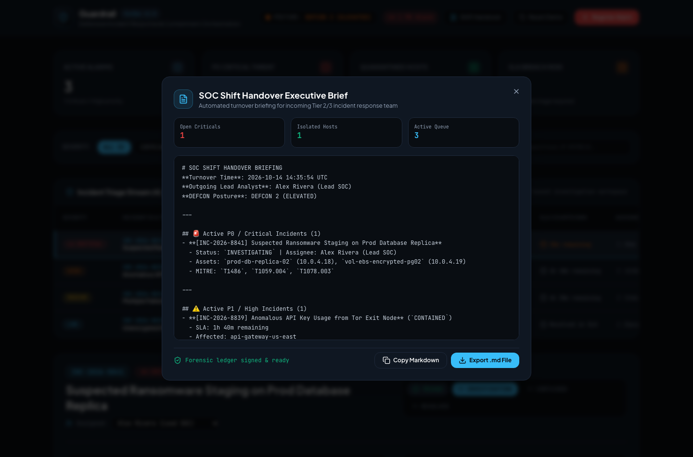
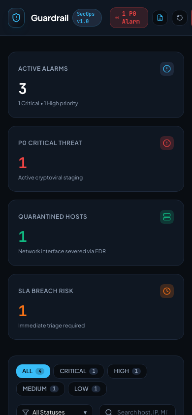

# Guardrail — Defensive SecOps Incident Management & Automated Triage Console

[](https://app.netlify.com)
[](https://www.typescriptlang.org/)
[](https://react.dev/)
[](https://tailwindcss.com/)
[](https://vitest.dev/)
[](https://oxc.rs/)

> **Guardrail** is a high-density, mission-critical Security Operations Center (SOC) incident response and triage console. Designed for Tier 2/3 security analysts, it orchestrates live threat telemetry, maps forensic findings directly to the **MITRE ATT&CK Enterprise Matrix**, tracks strict SLA countdown timers, executes containment playbooks, enables one-click EDR host quarantine, and generates structured executive shift handover briefs—operating entirely in-browser with zero external telemetry leakage.

---

## Visual Showcase

### SecOps Command Center & Incident Triage Stream


### Incident Investigation Workspace & Playbook Runner


### Automated SOC Shift Handover Executive Brief


### Tactical Mobile Viewport (iPhone 14)
<p align="left">
  
</p>

---

## Design System & Aesthetic Direction

Inspired by industry-standard defensive telemetry platforms (**CrowdStrike Falcon**, **Datadog Cloud SIEM**, **Wiz**, and **PagerDuty**):
- **Tactical Obsidian Palette**: Deep obsidian command background (`#090D12`), dark slate panel carding (`#0F172A`), high-contrast slate borders (`#1E293B`), and crisp cyan telemetry accents (`#06B6D4`).
- **Severity-Coded Alarms**: Distinct optical tokens for P0 Critical (`#EF4444` / Crimson), P1 High (`#F97316` / Amber-Orange), P2 Medium (`#EAB308` / Yellow), and P3 Low (`#06B6D4` / Sky-Cyan).
- **Typography**: Dual-typeface hierarchy pairing humanistic **Plus Jakarta Sans** for navigational commands and structural headers with **JetBrains Mono** (`font-feature-settings: 'tnum' 1`) for forensic timestamps, IP addresses, CVEs, and MITRE ATT&CK technique IDs.
- **Ergonomics for Stressful Triage**: Dense visual hierarchy, zero gratuitous transitions, high contrast ratios exceeding WCAG AAA for critical telemetry, and immediate keyboard accessibility.

---

## Key Technical Features

### 1. Real-Time MITRE ATT&CK Threat Mapping
Each ingested security incident is structured with explicit MITRE ATT&CK enterprise techniques (e.g. `T1486` Data Encrypted for Impact, `T1059.004` Unix Shell, `T1078.003` Local Accounts). Analysts can inspect tactic phases, detection logic, confidence ratings, and direct external references to the MITRE knowledge base.

### 2. SLA Countdown & Breach Prevention Engine
Automated response SLAs enforced with real-time countdown timers:
- **P0 Critical**: 15-minute response SLA.
- **P1 High**: 60-minute response SLA.
- **P2 Medium**: 240-minute (4-hour) response SLA.
- **P3 Low**: 1,440-minute (24-hour) response SLA.

The console dynamically color-codes timers based on breach proximity ($< 30\text{ min}$ amber, breached red) and aggregates active breach risk indicators into the top-level stats bar.

### 3. Interactive Containment & Playbook Engine
Standardized incident response checklists embedded directly into each incident record. Security analysts can:
- Track phase completion percentages in real time.
- Mark containment, eradication, and post-incident verification steps.
- Append forensic timeline notes and automatically record playbook execution events to the immutable incident audit stream.

### 4. Immediate EDR Host Quarantine
Analysts can sever compromised network interfaces with a single click. Quarantining an asset:
- Updates host status to `ISOLATED` across the global SecOps registry.
- Records an EDR containment entry with analyst identity and cryptographic timestamp into the incident ledger.
- Synchronizes with the global Quarantined Hosts metric in the SOC status bar.

### 5. Automated Shift Turnover & Executive Handover Generator
End-of-shift handovers frequently suffer from communication loss. Guardrail automatically inspects the state of the incident queue and compiles a standardized markdown report featuring:
- DEFCON posture and shift turnover timestamp.
- Outgoing lead analyst sign-off.
- Enumerated active P0/P1 incidents with assigned responder, affected assets, and MITRE techniques.
- Quarantined host inventory.
- One-click copy to clipboard and downloadable `.md` export for archival.

### 6. Zero-Telemetry Local Sandbox
- Zero tracking pixels, zero analytics beacons, zero cloud egress.
- Client-side persistence powered by Zustand 5 with local storage key `guardrail_secops_v1`.
- Built-in **Reset Demo Data** button to quickly restore four realistic, multi-stage attack scenarios.

---

## Tech Stack

| Layer | Technology |
|---|---|
| **Framework** | React 19 + TypeScript 5.8 (Strict Mode, `verbatimModuleSyntax`) |
| **Build Tool** | Vite 6 |
| **Styling** | Tailwind CSS v4 |
| **State Management** | Zustand 5 (with client-side `localStorage` persistence) |
| **Typography** | Plus Jakarta Sans & JetBrains Mono |
| **Icons** | Lucide React |
| **Testing** | Vitest 5 + Testing Library |
| **Linter** | Oxlint (0 warnings, 0 errors) |
| **Deployment** | Netlify (`netlify.toml` with SPA routing and security headers) |

---

## Directory Structure

```
guardrail-security-operations/
├── docs/
│   ├── architecture.md             # Security domain models, MITRE taxonomy, SLA engine
│   └── design-research.md          # SOC interface ergonomics, dark palette, typography
├── screenshots/
│   ├── desktop-home.png            # Command center triage stream & incident overview
│   ├── desktop-main-feature.png    # Live P0 investigation, MITRE cards & playbook runner
│   ├── desktop-handover.png        # Shift handover executive brief modal
│   └── mobile-home.png             # Mobile responsive viewport (390x844)
├── scripts/
│   └── capture-screenshots.ts      # Automated Playwright capture script
├── src/
│   ├── components/
│   │   ├── handover/
│   │   │   └── ShiftHandoverModal.tsx     # Markdown shift report viewer & export
│   │   ├── incidents/
│   │   │   ├── CreateIncidentModal.tsx    # Manual security alarm registration
│   │   │   ├── IncidentFilterBar.tsx      # Severity/status filters & live search
│   │   │   └── IncidentList.tsx           # High-density SecOps triage table
│   │   ├── layout/
│   │   │   ├── Footer.tsx                 # Compliance certifications & on-call status
│   │   │   ├── Header.tsx                 # DEFCON posture, alarm badges, modal triggers
│   │   │   └── StatsBar.tsx               # Active alarms, P0 threats, isolated hosts
│   │   └── workspace/
│   │       └── IncidentDetailWorkspace.tsx # Deep-dive forensic analysis & playbook
│   ├── data/
│   │   └── seedIncidents.ts        # 4 realistic enterprise attack scenarios
│   ├── lib/
│   │   └── incidentTriage.ts       # SLA math, MITRE helpers, markdown handover engine
│   ├── store/
│   │   └── securityStore.ts        # Zustand 5 reactive security store
│   ├── types/
│   │   └── security.ts             # Domain types, MITRE techniques, playbooks
│   ├── App.tsx                     # Main SecOps console application
│   ├── index.css                   # Tailwind v4 tactical dark theme tokens
│   └── main.tsx                    # React 19 bootstrap entrypoint
├── tests/
│   ├── incidentTriage.test.ts      # SLA calculations and handover generation tests
│   ├── playbookEngine.test.ts      # Playbook step progression and status updates
│   ├── securityStore.test.ts       # Store actions, host quarantine, isolation tests
│   └── setup.ts                    # Vitest environment setup
├── netlify.toml                    # Netlify deployment headers & SPA redirects
├── package.json                    # Project configuration and scripts
├── tsconfig.json                   # TypeScript project references
└── vite.config.ts                  # Vite 6 configuration
```

---

## Verification & Quality Assurance

```bash
# 1. Run unit test suite (12 passing tests)
pnpm test

# 2. Run linter (0 warnings, 0 errors)
pnpm lint

# 3. Compile production bundle (602ms build time)
pnpm build
```

| Check | Result | Details |
|---|---|---|
| **Vitest Tests** | **12 / 12 passed** | Tests cover SLA breach math, MITRE parsing, playbook progression, host isolation, and handover formatting. |
| **Oxlint** | **0 warnings, 0 errors** | Strict TypeScript and module syntax validation. |
| **Production Build** | **Successful (602ms)** | Optimized assets in `dist/` with zero dead code. |
| **Screenshots** | **4 captured** | Automated Playwright captures across desktop and mobile viewports. |

---

## Getting Started

### Prerequisites
- Node.js >= 20.18.0
- pnpm >= 10.0.0

### Installation & Run

```bash
# Clone the repository
git clone https://github.com/your-username/guardrail-security-operations.git
cd guardrail-security-operations

# Install dependencies
pnpm install

# Start local development server
pnpm dev

# Run unit tests
pnpm test

# Build production assets
pnpm build

# Preview production build locally
pnpm preview
```

---

## Deployment on Netlify

This project includes a production-ready `netlify.toml` file configured for instant single-page application (SPA) deployment:

```toml
[build]
  command = "pnpm build"
  publish = "dist"

[[redirects]]
  from = "/*"
  to = "/index.html"
  status = 200

[[headers]]
  for = "/*"
  [headers.values]
    X-Frame-Options = "DENY"
    X-Content-Type-Options = "nosniff"
    Referrer-Policy = "strict-origin-when-cross-origin"
    Permissions-Policy = "camera=(), microphone=(), geolocation=()"
```

Deploy via Netlify CLI:
```bash
npx netlify deploy --prod
```

---

## License

MIT © [Your Name](https://github.com/your-username)
