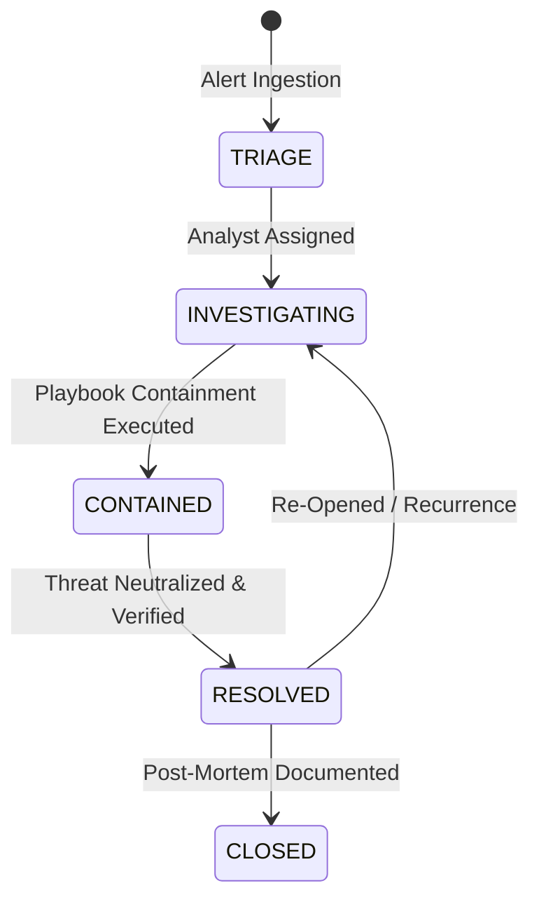

# Guardrail — Architecture & Technical Specifications

## 1. Executive Summary

Guardrail is an enterprise SecOps incident management and response orchestration console designed for Tier 2/3 SOC analysts. It solves the critical bottleneck in enterprise security operations: fragmented tools across SIEM alert queues, EDR host containment, MITRE ATT&CK mapping, and manual shift handover logs.

---

## 2. Domain Data Architecture

### Core Domain Entities (`src/types/security.ts`):
- `Severity`: `'CRITICAL' | 'HIGH' | 'MEDIUM' | 'LOW' | 'INFO'`
- `IncidentStatus`: `'TRIAGE' | 'INVESTIGATING' | 'CONTAINED' | 'RESOLVED' | 'CLOSED'`
- `Asset`: Network endpoint, cloud IAM role, database, or container pod with risk score and isolation status.
- `MitreTechnique`: MITRE ATT&CK taxonomy mapping ID, name, tactic, and threat description.
- `IncidentEvent`: Forensic timeline entry recording timestamp, actor, telemetry source, and event narrative.
- `PlaybookStep`: Interactive containment action with required prerequisite, automated timestamping, and executor attribution.
- `Incident`: Comprehensive record encapsulating assets, playbooks, timeline, and SLA deadlines.

---

## 3. SLA Breach & Pacing Mathematics

Every incident has an automated SLA countdown timer based on its severity at creation:
$$\text{SLA Deadline} = T_{\text{created}} + \Delta_{\text{severity}}$$

| Severity | SLA Target ($\Delta$) | Notification Threshold (80%) |
|---|---|---|
| **CRITICAL** | 60 minutes | 48 minutes elapsed |
| **HIGH** | 240 minutes (4 hours) | 192 minutes elapsed |
| **MEDIUM** | 720 minutes (12 hours) | 576 minutes elapsed |
| **LOW** | 1,440 minutes (24 hours) | 1,152 minutes elapsed |

$$\text{Time Remaining} = \max(0, \text{SLA Deadline} - T_{\text{current}})$$
$$\text{Breach Status} = \begin{cases} \text{'BREACHED'}, & \text{if } T_{\text{current}} > \text{SLA Deadline} \land \text{Status} \neq \text{'RESOLVED'} \\ \text{'WARNING'}, & \text{if } \text{Time Remaining} < 0.2 \times \Delta \\ \text{'ON\_TRACK'}, & \text{otherwise} \end{cases}$$

---

## 4. Response Playbook Engine

Each incident attaches a domain-specific containment playbook (e.g. *Ransomware Staging*, *Compromised Cloud Credentials*, *DDoS Ingress Mitigation*):
1. **Interactive Check-off**: Toggling a step records the exact UTC timestamp and marks step status.
2. **Containment Side-Effects**: Executing a host containment step triggers the `isolateAsset` action, severing network ingress/egress while retaining forensic memory dump channels.
3. **Automated Status Advancement**: When all containment steps are completed, the incident status automatically transitions from `INVESTIGATING` to `CONTAINED`.

---

## 5. Automated Shift Handover Brief Generator

At the end of an 8-hour shift, the analyst generates an executive brief. The generator compiles:
- Active Critical and High priority incidents.
- Contained assets awaiting forensic wipe.
- SLA countdown warnings approaching breach.
- Formats an RFC-compliant markdown brief ready for Slack / PagerDuty / Jira dissemination.
